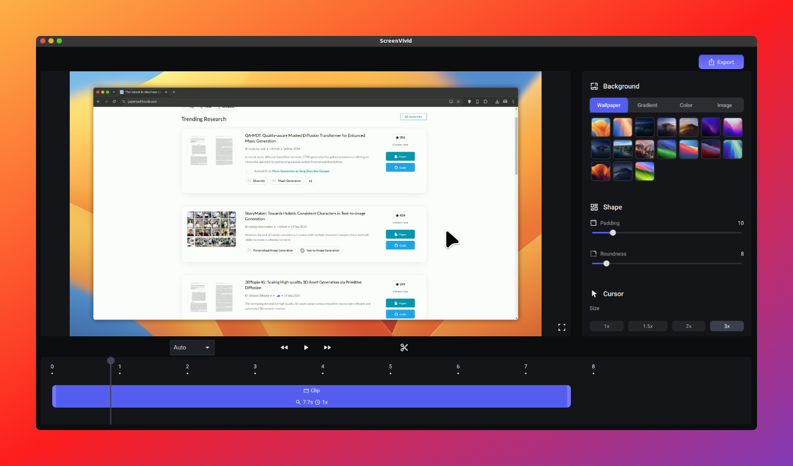

<div align="center">
  

  # ScreenVivid

  [](https://opensource.org/licenses/MIT)
  [](https://github.com/tamnguyenvan/screenvivid/releases)
  [](https://www.python.org/downloads/)
  [](https://github.com/tamnguyenvan/screenvivid/releases)
  [](https://discord.gg/NKtmBnR6nE)

  <p><em>Simple, powerful screen recording for everyone</em></p>
</div>

<div align="center">
  
</div>


## 🚀 Overview

[ScreenVivid](https://screenvivid.com) is a simple and user-friendly screen recording application with intuitive editing features. Capture tutorials, meetings, or gameplay with ease on any platform!

## ✨ Features

- **💻 Cross-platform support** - Available on Windows, macOS, and Linux
- **🎥 High-quality recording** - Professional-looking video capture
- **🔧 Video enhancement tools** - Add backgrounds, padding, and more
- **🎨 Intuitive interface** - Start recording with just a few clicks
- **🆓 Free and open-source** - No hidden costs or limitations

## 📥 Installation

### System Requirements

| Platform | Requirements |
|----------|-------------|
| Windows | Windows 10+, 4GB RAM (8GB recommended) |
| macOS | macOS 11.0+, 4GB RAM (8GB recommended) |
| Linux | Python 3.9+, glibc 2.28+, X11, 4GB RAM (8GB recommended) |

### 🐧 Linux

```bash
# Ubuntu/Debian
sudo dpkg -i screenvivid-x.x.x-amd64.deb
sudo apt install -f  # If missing dependencies
```

### 🪟 Windows

1. Download the latest installer from [Releases](https://github.com/tamnguyenvan/screenvivid/releases)
2. Run the installer (click through security warnings)
3. Launch from Start Menu or Desktop shortcut

> ⚠️ **Note**: App is not yet code-signed (security warnings may appear)

### 🍎 macOS

1. Download .dmg from [Releases](https://github.com/tamnguyenvan/screenvivid/releases)
2. Drag ScreenVivid to Applications folder
3. To bypass Gatekeeper: System Settings → Privacy & Security → "Open Anyway"

### 🧪 Running from Source

<details>
<summary>Click to expand instructions</summary>

#### 1. Install system dependencies

```bash
# Ubuntu/Debian
sudo apt install python3-tk python3-dev libxcb-cursor0 ffmpeg

# Fedora
sudo dnf groupinstall -y "Development Tools" && sudo dnf install -y python3-devel python3-tkinter xcb-util-cursor ffmpeg

# macOS
brew install ffmpeg

# Windows
# Download FFmpeg from GitHub and place in project root
```

#### 2. Install Python dependencies

```bash
# Linux
pip install -r requirements.txt

# macOS
pip install "pyobjc-framework-Quartz>=10.3.1,<10.4" "pyobjc-framework-UniformTypeIdentifiers>=10.3.1,<10.4" "pyobjc-framework-AVFoundation>=10.3.1,<10.4" && pip install -r requirements.txt

# Windows
pip install "pywin32>=306,<308" && pip install -r requirements.txt
```

#### 3. Compile and Run

```bash
cd screenvivid
python compile_resources.py
python -m screenvivid.main
```
</details>

## 💪 Advantages

- **👍 Easy to use** - Intuitive interface for all skill levels
- **🌍 Cross-platform** - Works on your preferred operating system
- **💯 High quality** - Crystal clear screen recordings
- **🆓 Always free** - No premium tiers or hidden costs

## ⚠️ Current Limitations

- No audio capture or webcam integration yet
- Application size is larger than optimal
- Advanced editing features still in development

## ❓ FAQ

<details>
<summary><b>Is ScreenVivid free?</b></summary>
Yes! ScreenVivid is completely free and open-source.
</details>

<details>
<summary><b>Is it safe despite security warnings?</b></summary>
Yes. We haven't obtained a code signing certificate yet (budget constraints), but our software is safe to use.
</details>

<details>
<summary><b>How can I contribute?</b></summary>
We welcome contributions! Check our GitHub repository or contact us directly.
</details>

<details>
<summary><b>Missing packages when installing on Linux?</b></summary>
Run <code>sudo apt install -f</code> to install missing dependencies.
</details>

## 🗺️ Roadmap

- [ ] 🎤 Audio capture support
- [ ] 🎬 Webcam integration
- [ ] 🔍 Zoom and highlighting tools
- [ ] 🎞️ Export to GIF format
- [ ] 📦 Output file compression

## 📄 License

[](https://opensource.org/licenses/MIT)

## 🔗 References

- [PySide6](https://pypi.org/project/PySide6/)
- [python-mss](https://github.com/BoboTiG/python-mss)
- [pyautogui](https://github.com/asweigart/pyautogui)

## 🆘 Support

- 💬 [Discord Community](https://discord.gg/NKtmBnR6nE)
- 📧 Email: tamnnv.work@gmail.com
- 📝 [Report Issues](https://github.com/tamnguyenvan/screenvivid/issues)

---

<div align="center">
  <p>Thank you for choosing ScreenVivid! If you find our software helpful, please consider supporting our development. 💖</p>
  
  <h3>Support My Side Projects</h3>
  <a href="https://iconfst.com">IconFst</a>
</div>
